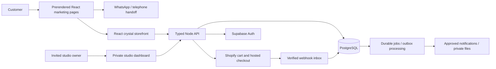

# Crystals Chakra: production product plan

Status: active goal; M0 audit and M1 WhatsApp-first public journey delivered. The typed API and native PostgreSQL foundation are implemented and tested locally; owner operations, full commerce and hosted verification remain in progress. Updated 7 November 2026, Asia/Kolkata.

This is the current source of product direction. It supersedes conflicting earlier planning notes in REBUILD.md. It describes the target, not features already delivered. See [the audit](TECHNICAL-AUDIT.md), [ordered backlog](IMPLEMENTATION-BACKLOG.md), and [reviewed skills](SKILLS-SOURCES.md).

## Goal and confirmed decisions

Build a dependable business website that primarily sells tarot and astrology readings, with crystals as a secondary ecommerce business. The website should also provide credible, inspectable evidence of Sahib's engineering work on GitHub.

- Reading enquiries go **straight to WhatsApp**, as requested by the business. No mandatory website form, customer account, calendar or checkout before a conversation.
- English is the main interface language. Use owner-approved Hindi titles as carefully styled elements in the reading sections, rather than assuming a fully translated application was requested.
- Tarot can involve a conversation; astrology can involve a consultation and/or report. Exact durations, delivery methods, included reports and turnaround remain unconfirmed. Do not turn provisional details into published promises.
- Preserve the actual logo artwork and its brand colours, plus the sidebar and header animation features. The owner has now authorized larger changes to layout, section order, fonts and the wider palette. Keep the approachable royal/cosmic direction and clear contact hierarchy; validate substantial visual changes locally.
- The current main sequence is opening, tarot, astrology packages, crystal shop invitation, information, contact, questions; the owner now permits revising that order where it improves the customer journey. The existing booking section becomes a contact hub; the crystal shop stays a separate page.
- Contact options must remain obvious without discovering hover interactions. Preserve the sidebar as an additional navigation route.
- Production targets Vercel for the frontend, Render for the backend/worker and Supabase for managed data/auth/storage. Local development stays isolated, with separate databases, credentials and provider modes. Local implementation does not constitute a production launch, connected merchant account or paid subscription purchase.

## The customer experience

### Readings: the main business

1. Within the opening screen, understand that this is a real tarot/astrology studio and see a large, clearly labelled WhatsApp action.
2. Choose tarot or an astrology package. Each package answers: what it includes, its confirmed price or enquiry status, who provides it, and how to ask about it.
3. Select **Ask about this reading on WhatsApp**. Open a short prefilled message containing the package title and any approved advertised price/reference. Avoid birth details or other personal information in the URL.
4. The customer sends the message in WhatsApp. The owner confirms the reading, timing, delivery and payment directly.
5. Offer **Call the studio** with a proper telephone link, a visible number and a copy-number option if WhatsApp is unavailable. A desktop QR code can be an additional route, without replacing the ordinary link.

The site must never claim a message was sent, a booking confirmed or a payment received because someone clicked a link. WhatsApp click-to-chat opens a conversation with a prefilled text field; the customer still sends it. [WhatsApp documentation](https://faq.whatsapp.com/5913398998672934/).

The free cosmic reading remains a substantial optional tool. Its date-only calculation stays in the browser, with a plain explanation before input. It should support interest in the studio without making the paid business difficult to find.

### Crystals: a secondary shop with real commerce

- Product details, actual photographs, variants, availability and prices in INR.
- A genuine multi-item cart with quantity changes and remove controls. Guest checkout is the default.
- Shopify owns authoritative product stock, checkout totals, shipping, payment collection and order state. The custom storefront uses its Storefront Cart API and hands the customer to hosted checkout. [Shopify cart guidance](https://shopify.dev/docs/storefronts/headless/building-with-the-storefront-api/cart/manage).
- Clearly show shipping/serviceability information, delivery expectations and approved returns/refund policies before purchase. Do not invent delivery times, discounts or stock urgency.
- Handle expired carts, sold-out variants, changed prices, interrupted checkout and upstream failures. A browser return from checkout does not prove payment.
- Use verified Shopify webhook events and reconciliation to update a limited local order projection where needed for the owner dashboard. Avoid independently maintaining a second inventory ledger.
- Keep illustrative preview mode explicitly distinct from a live store. Test mode must not accept real money.

### Owner operations

Provide an invite-only studio dashboard, separate from public marketing pages:

- Edit packages, approved Hindi names, practitioner details and WhatsApp destinations.
- Draft, preview, publish and expire advertising offers using structured fields and real validity dates.
- Record enquiries/bookings the owner actually receives in WhatsApp or by phone. Store only the contact information needed to fulfil the request.
- Track consultation status independently from payment status. Initially, reading payments are arranged by the owner in the conversation; the dashboard must distinguish manually recorded payment from provider-verified shop payment.
- Review shop orders, fulfilment references and integration errors.
- Add optional private report delivery only after the studio confirms it will use it; use access-controlled storage and expiring links.
- Keep an application audit trail for price changes, publishing, contact-record access and important status changes.

A WhatsApp click is not a CRM conversation record. Basic click-to-chat cannot read replies or import chat history. Automated inbound handling requires a separately configured WhatsApp Business Platform integration; do not scrape the Business app or silently enable automated messages.

## Visual direction and hierarchy

Design for customers who want a personal, trustworthy service, including people unfamiliar with contemporary web conventions. Validate this with representative users rather than treating all Indian customers as one audience.

| Priority | What the customer should see                            | Design rule                                                |
| -------- | ------------------------------------------------------- | ---------------------------------------------------------- |
| First    | What readings are offered and how to contact the studio | Large ordinary language, visible WhatsApp and Call actions |
| Second   | The reader, the package and the confirmed price         | Real portraits, readable cards, clear inclusions           |
| Third    | An optional crystal purchase                            | Smaller invitation and a dedicated shop                    |
| Fourth   | Explanations and the free tool                          | Accessible supporting content, not an obstacle to contact  |

- Build familiarity through the advertisement's royal colours, deliberate borders, warm imagery and restrained Hindi typography.
- Keep a small coherent font system. Render Devanagari words as properly shaped text; do not split conjuncts into per-character animations. Mark meaningful Hindi text with lang="hi". Hide duplicated decorative Hindi from assistive technology when its meaning is already present in English.
- Use real studio/practitioner/product assets when supplied. No invented testimonials, stock-photo impersonation, fake customer counts, unverified credentials or claims of guaranteed outcomes.
- Remove repetitive eyebrows, numbered badges, duplicate summaries and decorative tiny text. Use whitespace to group related content rather than create empty screens.
- Keep touch targets comfortably large, preferably at least 44 CSS pixels for primary controls. WCAG 2.2 AA's target-size criterion has a 24-pixel minimum with defined exceptions; 44 pixels here is our usability target, not a claim about that minimum. [W3C guidance](https://www.w3.org/WAI/WCAG22/Understanding/target-size-minimum.html).
- Preserve keyboard navigation, visible focus, readable contrast, browser zoom and sensible 200% text scaling. Do not make the side rail or 3D scene the only route to an action.
- On mobile, a compact WhatsApp/Call action bar can supplement the header, with safe-area padding and no obstruction of forms or shop checkout controls.

### Motion budget

- Use motion to guide attention, show relationships and acknowledge interaction.
- Preserve the shared tarot/services background and the portrait entrance from the right.
- Use opacity and transforms for content entrances. Keep scroll responsive; avoid scroll hijacking and long entrance delays.
- The rings remain a progressive enhancement. Public content and contact links must render independently of WebGL. Defer the 3D download until after essential content; use a lightweight still fallback for unsupported, constrained or reduced-motion devices.
- Existing user preference removes a pause button from the rings. Preserve that preference while providing an accessible reduced-motion/static experience and assessing a discreet page-level motion setting for prolonged decorative movement.
- Stop nonessential animation when offscreen or the tab is hidden. Keep the native pointer usable; decorative cursor effects never intercept clicks or replace text-entry feedback.

## Proposed architecture

Build a **modular monolith** in this repository. Modules should have clear responsibilities and tests; separate deployable microservices are not required for this business.



### Technology decisions

| Layer               | Direction                                                                                                    | Why it belongs                                                                                 |
| ------------------- | ------------------------------------------------------------------------------------------------------------ | ---------------------------------------------------------------------------------------------- |
| Public frontend     | Keep React; move touched modules toward strict TypeScript                                                    | Preserve the design while making business contracts explicit                                   |
| Rendering           | Add build-time prerendering for public pages, metadata and contact links; retain interactive React           | Ad visitors, search crawlers and messaging previews receive useful HTML immediately            |
| Backend             | Evolve the native HTTP scaffold into a typed Fastify modular API                                             | Schema validation, structured logging, lifecycle control and documented routes                 |
| Contracts           | One shared schema system, proposed TypeBox/JSON Schema, with OpenAPI output                                  | Runtime validation and client types describe the same business rules                           |
| Database            | Supabase PostgreSQL, SQL migrations and deliberate transactions                                              | Persistent owner data, relational constraints, permissions and realistic production testing    |
| Admin identity      | Supabase Auth with invitation/allowlist, server-verified identity and MFA                                    | Managed identity; real authorization is checked at every protected boundary                    |
| Shop                | Shopify Storefront Cart API and hosted checkout                                                              | Authoritative commerce without maintaining card handling or duplicate stock logic              |
| Background work     | PostgreSQL-backed inbox/outbox and worker, once integrations require it                                      | Durable processing, retries and reconciliation without introducing a queue service prematurely |
| Client server-state | Add a query/cache layer where admin/cart complexity warrants it                                              | Explicit loading, invalidation, cancellation and recoverable errors                            |
| Hosting             | Vercel frontend, Render API/worker, Supabase database/storage                                                | Matches the requested providers and existing preparation                                       |
| Quality             | Current tests plus type checking, API/database tests, browser journeys, accessibility and performance checks | Evidence that critical workflows work beyond a successful build                                |

Verify compatible package versions and official integration instructions when introducing each dependency. Keep Next.js-specific skill advice out of the Vite application unless a separately documented rendering decision changes that choice.

Render's free web services sleep after inactivity and its documentation advises against production use. Plan always-available production compute for customer-facing API work; do not make the Contact link depend on a sleeping server. Hosting tiers and purchases remain an owner decision. [Render limitations](https://render.com/docs/free).

### Module boundaries

```text
src/
  app/                  routing, providers, page composition
  features/readings/    packages, reader profiles, WhatsApp handoff
  features/contact/     phone, copy-number, accessibility, contact hub
  features/shop/        catalogue, product details, cart
  features/studio/      invited owner dashboard
  features/cosmic/      private date-only tool and optional 3D scene
  components/ui/        consistent buttons, forms, dialogs, cards
  styles/               tokens, typography, motion and component styles
server/
  modules/catalog/      public package/practitioner publishing
  modules/studio/       private operations and authorization
  modules/commerce/     Shopify adapters and cart orchestration
  modules/webhooks/     authenticated durable event intake
  modules/analytics/    minimal aggregate contact-intent events
  jobs/                 retryable integration work
  infrastructure/       configuration, database, logging, provider clients
shared/contracts/       validated API schemas and shared types
supabase/migrations/    schema, grants, RLS and index changes
tests/                  domain, integration, database, browser and failure tests
docs/                   ADRs, API contract, runbooks and measured case study
```

Move files incrementally behind working interfaces. The directory layout is a target, not a reason to rewrite functioning UI in one operation.

### Data ownership

- Public database content: practitioners, reading packages, approved offers, published media metadata and business contact settings.
- Private studio records: customer contact details supplied to the studio, confirmed work, consultation status, private notes and audit events. No unauthenticated listing or guessable reference access.
- Commerce: Shopify remains the system of record. Keep only required local order references and state for operations, with provider ID uniqueness.
- Integration: webhook inbox and outbox/job records carry event IDs, status, retry times and minimal payloads. Use database constraints for deduplication and atomic state changes.
- Analytics: aggregate click intent, service and approved campaign identifiers. Do not record birth dates, full chat messages, phone numbers or arbitrary URL query strings in analytics.
- Store timestamps as timestamptz and show studio times in Asia/Kolkata. Store money as integer minor units or exact decimals, never floating-point charge calculations.

## Security and operational acceptance

Use an explicit set of applicable OWASP ASVS requirements as testable controls, rather than labelling the site completely secure. [OWASP ASVS](https://asvs.owasp.org/).

- Authentication and server-side role checks on every private endpoint; MFA for owner access; no public admin registration.
- RLS/grants and storage access tests for public, signed-in outsider and approved owner roles. A server service key bypasses RLS, so its routes still require explicit authorization. [Supabase production security](https://supabase.com/docs/guides/security/production-checklist).
- Bounded request bodies, timeouts, strict schemas, safe query construction, configured external destinations and validated uploads. Do not accept arbitrary published HTML or executable SVG uploads.
- Managed session handling, secure production cookies where appropriate, CSRF protection for cookie-authenticated writes, and deliberate cross-origin configuration.
- Trusted-proxy-aware abuse controls, distributed enforcement where needed, and no blind trust in forwarded client-IP headers.
- Verify webhook signatures against the raw body before trusting an event. Persist a unique event before acknowledgement; make business transitions idempotent and recover out-of-order deliveries. Never treat a frontend success callback as payment evidence.
- Redact credentials, personal details, reports, signed URLs and chat text from logs. Use request IDs and business references for debugging.
- Add security headers and test them on the actual hosted response. Introduce CSP in report-only mode before enforcement where appropriate; distinguish script rules from style attributes needed by motion.
- Define retention, deletion, backups, restore drills, monitoring, incident contacts and rollback procedures. Validate applicable Indian privacy and consumer requirements with the business before launch; this plan is not a legal compliance certification.

## Performance and accessibility acceptance

- Public HTML includes the studio's purpose, reading titles and functional WhatsApp/telephone links before JavaScript hydration.
- Target mobile field Core Web Vitals at the 75th percentile: LCP at or below 2.5 seconds, INP at or below 200 ms and CLS at or below 0.1. Lab results are development evidence, not field measurements. [Metric definitions](https://web.dev/articles/vitals).
- Record a reproducible lab baseline on a throttled mobile profile; set bundle and image budgets from that baseline. Keep decorative 3D outside the critical content path.
- Check 320, 375, 768 and 1280-pixel layouts, keyboard-only use, zoom, reduced motion, touch alternatives and a representative physical Android phone.
- Compress/responsively size real images, reserve image dimensions, self-host appropriately licensed fonts and avoid duplicate font downloads.
- Separate cacheable public catalogue data from private responses. Use bounded caching/invalidation and graceful upstream failures.

## Delivery milestones and proof

| Milestone                           | Deliverable                                                                                             | Completion evidence                                                                         |
| ----------------------------------- | ------------------------------------------------------------------------------------------------------- | ------------------------------------------------------------------------------------------- |
| M0 — audit and plan                 | Confirm owner flow, record baseline, research and skills                                                | This plan, audit, backlog, reviewed skill registry                                          |
| M1 — WhatsApp-led public experience | Direct reading actions, contact hub, call fallback, approved Hindi title treatment                      | Link/format tests and desktop/mobile browser verification; no false booking confirmation    |
| M2 — backend foundation             | Typed modular API, validated contracts, Postgres development parity, migrations and CI                  | Contract, transaction, migration and real-Postgres integration tests                        |
| M3 — owner administration           | Invited access, package/practitioner/offer editing, consultation operations                             | Outsider access denied, owner actions work, audit trail verified                            |
| M4 — secondary ecommerce            | Product/variant pages, durable multi-item cart, Shopify hosted checkout                                 | Sandbox purchase/cancel/refund scenarios, tamper/out-of-stock tests, verified order updates |
| M5 — reliability and acquisition    | Durable integration processing, monitoring, prerendering, SEO, ad content and privacy-aware attribution | Retry/reconciliation tests, correct previews and no PII in telemetry                        |
| M6 — hardening and launch           | Accessibility, load/failure checks, backup restore, live configuration and policies                     | Staging evidence, external-service verification, launch checklist and rollback drill        |
| M7 — portfolio case study           | Architecture decisions, test instructions, measured before/after evidence and walkthrough               | Reproducible public documentation with real outcomes clearly separated from demo data       |

Work proceeds through the milestones without repeatedly requesting approval for ordinary code edits. External accounts, verified business facts, actual portraits, live merchant acceptance and paid service purchases cannot be fabricated. When one is unavailable, finish the adapter, local demo and tests, record the remaining dependency and continue other authorized work.

## GitHub evidence that should impress a reviewer

Typed contracts, transactions, migrations, RLS tests, invite-only RBAC, verified and idempotent webhooks, a real cart, resilient integrations, structured redacted logs, CI/security checks, accessible motion and measured performance all belong because they solve this product's problems.

Add focused architecture decision records, a clean setup path, seeded development data, an API reference, provider fakes, failure-case tests and operational runbooks. Keep public demo data separate from customer records. Explain tradeoffs and show measured results; do not invent revenue, customer counts, performance scores or claims of unaided authorship.

Each additional dependency needs a named customer/owner workflow and a maintenance reason. The public site should sell readings, while the repository and case study explain the engineering.

## Outstanding business inputs

- Approved practitioner names/portraits and who receives each category's enquiries.
- Confirmed package titles, inclusions, durations, delivery formats and prices; existing prices remain provisional until confirmed.
- Hindi wording and preferred spelling of the reading names.
- Business hours, call availability and actual response expectations.
- Actual crystal photographs, variants, inventory, serviceable locations and fulfilment process.
- Merchant, shipping, refund, privacy and contact details for production policies.
- Hosting/database/store accounts, domain ownership, budget and production credentials supplied through the providers' secure configuration paths.

These inputs refine publication and integration, but do not prevent implementation of the shared structure, local fixtures and tests.
