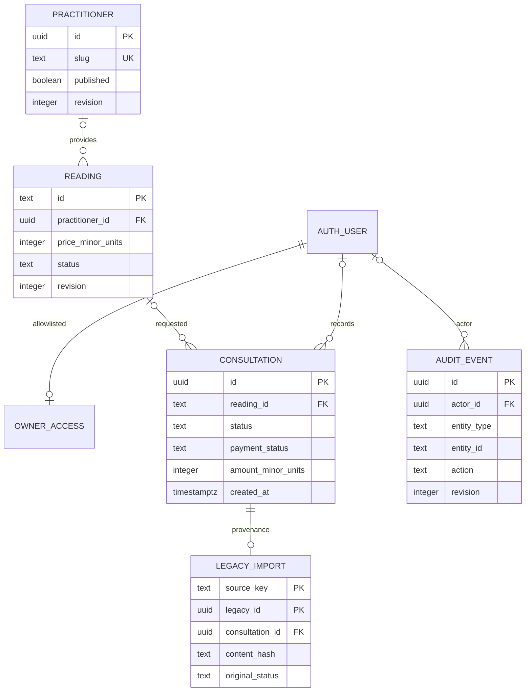

# ADR 002: PostgreSQL permissions and studio data

Date: 7 November 2026. Status: implemented locally; managed Supabase Auth and hosted configuration remain verification gates.

## Decision

Use PostgreSQL 17 for catalogue and studio operations. SQL migrations are versioned, checksummed and applied over a direct/session connection. A session advisory lock serializes migration runners; each migration's DDL and history row commit together. A failed migration rolls back. Historical checksum changes or missing applied files are errors. Do not run this session-lock workflow through a transaction pooler.

Separate `catalog` (publishable practitioner/reading content), `studio` (owner access, consultation records, provenance and audit), and `chakra_meta` (migration history). Leave the old `public.bookings` table and SQLite archive untouched. Real archived records are imported deliberately into private consultations, with original IDs/status and hashes retained in a separate mapping. Never infer consent, payment or a confirmed slot from an old request.

Readings store integer paise, with a whole-INR constraint matching the current display contract. Consultation amounts also use exact integer minor units; consultation progress and manually recorded payment status are distinct. Timestamps use `timestamptz`. Foreign keys and indexes support practitioner references, daily consultation lists, retention review and entity audit history. Retention review dates are explicit; no unapproved automatic deletion period is invented.

## Roles and trust boundaries

The app uses a restricted NOINHERIT login with membership in the NOLOGIN `chakra_runtime` role. Runtime startup refuses superuser, BYPASSRLS, role/database creation or replication privileges. It does not use the migration account or a service-role key. A small pool bounds connections and query/transaction-idle time; app shutdown closes it.

Each operation starts a transaction, selects either the anonymous or authenticated database role, and supplies transaction-local claims. Commit/rollback resets that context before the pooled connection is reused. Public code can query only published catalogue content. Private policies additionally require an active owner allowlist entry and an `aal2` claim.

The claim setter is an internal server boundary, not a public API. M3 must verify a real managed Auth JWT and MFA before establishing private database context. Tests that set claims deliberately do not prove JWT verification. Never accept a user ID or assurance level from an unverified request body/header.

RLS is forced for catalogue, consultations and import mapping tables. The private owner allowlist and append-only audit table have RLS enabled, no direct client write grants and narrow fixed-search-path security-definer helpers. Those two internal tables intentionally allow their owning trigger/helper to operate; forcing their owner through a deny-all policy would break that internal path. Other client roles cannot edit the allowlist or fabricate audit rows. Audit events store identity, entity, action and revision, without copying names, contact details or notes.

Remote connections verify TLS certificates; URL options cannot override the configured SSL policy. Optional trusted CA files support provider-specific chains. Plaintext is allowed only on loopback outside production. Server errors/logs do not disclose connection strings or query/provider exception details.

## Local parity and limits

Native PostgreSQL 17.11 runs in an ignored, project-local Windows folder. Test databases are uniquely named, contain synthetic fixtures and are dropped after their clients close. The test controller is separate from the development API login.

The plain-Postgres bootstrap models only Supabase's database-facing roles, user reference and JWT helper interfaces. It never runs as a hosted migration and does not emulate the full Auth service. The role/RLS/constraint/transaction tests run in real PostgreSQL; actual Supabase policies, JWT signing/JWKS, invitations and MFA service flows still need hosted verification.

The public API can serve the seeded catalogue from PostgreSQL. Without database configuration it uses the bundled catalogue. When a configured database query fails, it returns a controlled 503; the frontend retains contact and package information but hides potentially stale prices behind an enquiry action.

## Diagram

## Evidence and primary sources

12 real-database tests plus the existing 31 application tests pass locally. They cover concurrent migration/import deduplication, DDL rollback, checksum drift, anonymous/outsider/owner-MFA boundaries, context reset on the same pooled connection, exact amounts and foreign keys, transactional auditing, API role refusal and a synthetic SQLite CLI round trip. CI is configured with a digest-pinned official PostgreSQL image; remote CI and CodeQL results are not yet asserted.

- [Supabase database connections](https://supabase.com/docs/guides/database/connecting-to-postgres): direct/session connections for migrations and pooler boundaries.
- [Supabase RLS](https://supabase.com/docs/guides/database/postgres/row-level-security): grants plus policies and database-context testing.
- [Supabase securing data](https://supabase.com/docs/guides/database/secure-data): exposed schema and role restrictions.
- [PostgreSQL Windows distributions](https://www.postgresql.org/download/windows/) links the official EDB portable archive.
- [PostgreSQL 17 privileges](https://www.postgresql.org/docs/17/ddl-priv.html), [row security](https://www.postgresql.org/docs/17/ddl-rowsecurity.html), and [locking](https://www.postgresql.org/docs/17/explicit-locking.html) define the underlying controls.
